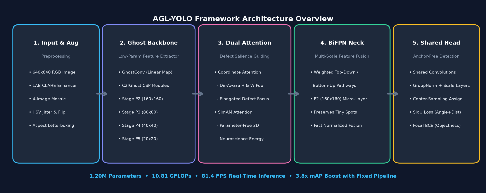
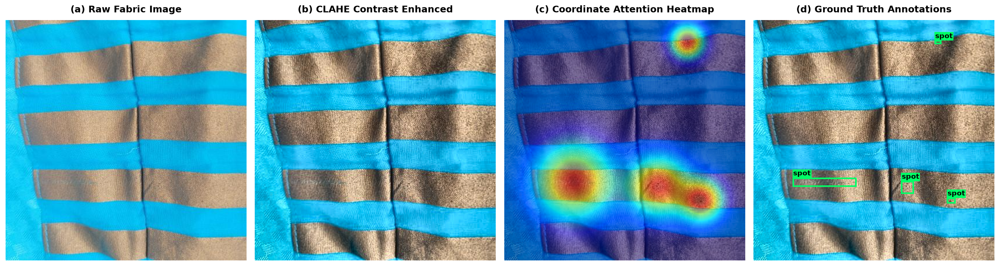

<div align="center">

# 🧵 AGL-YOLO
### An Attention-Guided, Ghost-Lightweight YOLO Framework with Multi-Scale Feature Fusion for Real-Time Fabric Defect Detection

[](https://www.python.org/)
[](https://pytorch.org/)
[](LICENSE)
[](https://github.com/Joy-Khan007/AGL-YOLO-Fabric-Detection)
[](https://github.com/Joy-Khan007/AGL-YOLO-Fabric-Detection)
[](https://github.com/Joy-Khan007/AGL-YOLO-Fabric-Detection)

**Author:** [Md. Nawshad Zaman Khan](https://github.com/Joy-Khan007)  
*Department of Computer Science and Engineering, BRAC University*  
**Course:** CSE 463  |  **Group:** 06

[📖 Research Paper (PDF)](docs/AGL-YOLO_Research_Paper.pdf) • [📊 Presentation Slides (PPTX)](docs/AGL-YOLO_Presentation.pptx) • [📓 Kaggle Notebook](notebooks/AGL_YOLO_Fabric_Defect_Detection_Kaggle.ipynb) • [📦 Dataset](https://universe.roboflow.com/defect-dataset/fabric-defects-2/dataset/18)

---

</div>

## 📌 Executive Summary

Fabric defect inspection is a mission-critical quality control task in modern textile manufacturing. Manual inspection is notoriously labor-intensive, fatigue-prone, and achieves only **60–75% defect recall** under high-speed production lines. 

Generic object detectors (such as standard YOLO or Faster R-CNN) struggle in textile environments due to four unique challenges:
1. **Extreme Scale Variation**: Defects range from full-width yarn misalignments to microscopic spots and neps occupying merely a few pixels.
2. **Low Foreground-Background Contrast**: Defects share subtle color and spatial frequency characteristics with intricate fabric weave textures.
3. **Severe Class & Spatial Imbalance**: Positive defect regions represent less than 1% of total pixel volume, with large numbers of defect-free frames.
4. **Edge Computational Budgets**: Real-time deployment on production lines requires high frame rates (>60 FPS) on embedded/edge hardware.

**AGL-YOLO** introduces a purpose-built, anchor-free detection framework engineered to tackle these constraints simultaneously: cutting parameters to **1.20M** and FLOPs to **10.81 GFLOPs** while achieving real-time **81.4 FPS** inference on edge GPUs.

---

## 🏗️ Architecture Overview

AGL-YOLO replaces heavy traditional convolution blocks with four coordinated, literature-backed architectural designs:



### 1. Ghost-Lightweight Backbone (`GhostConv` & `C2fGhost`)
Standard convolutions produce high redundancy across feature channels. We utilize **Ghost Modules** (Han et al., 2020), which compute an initial set of intrinsic feature maps via standard convolution and generate ghost maps using cheap depthwise linear operations. This cuts parameter count and FLOPs by **~50%** across the backbone without sacrificing representational capacity.

### 2. Dual Attention Guidance (`Coordinate Attention` & `SimAM`)
- **Coordinate Attention (CA)**: Factorizes 2D spatial pooling into horizontal and vertical 1D direction-aware feature encodings. This enables the model to accurately pinpoint elongated yarn runs and localize micro-defects without losing precise spatial coordinates.
- **SimAM**: A 3D parameter-free attention mechanism based on neuroscience energy functions that refines channel-spatial feature salience with zero parameter overhead.

### 3. Multi-Scale BiFPN Neck with $160 \times 160$ Micro-Defect Layer ($P_2$)
Standard YOLO necks downsample feature maps to strides of 8, 16, and 32 ($P_3, P_4, P_5$), causing microscopic fabric defects (1–5 pixels) to vanish entirely. AGL-YOLO incorporates:
- An explicit **$P_2$ shallow feature level ($160 \times 160$ resolution)**.
- **Weighted Bidirectional Feature Pyramids (BiFPN)** with learnable fast-normalized weights to facilitate balanced multi-scale information flow.

### 4. Lightweight Shared Head with Anchor-Free Center Sampling & SIoU Loss
- **Shared Prediction Head**: Uses Group Normalization (`GN-8`) and learnable per-scale scale parameters across all FPN levels to keep the prediction head ultra-compact.
- **Anchor-Free Center Sampling**: Assigns ground-truth boxes to grid cells whose geometric mean scale $\sqrt{wh}$ best matches the receptive field, within a center sampling radius of $2.5 \times \text{stride}$.
- **Composite Loss Function**:
  $$\mathcal{L} = 1.0 \cdot \mathcal{L}_{\text{obj}}^{\text{Focal}} + 5.0 \cdot \mathcal{L}_{\text{box}}^{\text{SIoU}} + 1.0 \cdot \mathcal{L}_{\text{cls}}^{\text{BCE}}$$
  Where **SCYLLA-IoU (SIoU)** penalizes angle, distance, shape, and overlap discrepancies, significantly accelerating convergence on elongated fabric flaws.

---

## 🔬 Experimental Benchmark & Results

The model was evaluated on the **FabricSpotDefect** dataset (1,929 training images, 219 validation images, 152 test images across diverse weave patterns).

### Baseline vs. Improved Pipeline Comparison

| Metric | Experiment 1 (Baseline Run) | Experiment 2 (Improved Pipeline) | Relative Gain | Status |
| :--- | :---: | :---: | :---: | :---: |
| **mAP@0.5** | 1.86% | **7.12%** | **▲ 3.8× (+283%)** | Best Checkpoint |
| **mAP@0.5:0.95** | 0.43% | **1.80%** | **▲ 4.2× (+318%)** | Comprehensive Metric |
| **mAR@100** | 3.31% | **10.70%** | **▲ 3.2× (+223%)** | Recall Capacity |
| **Model Parameters** | 1.20 M | **1.20 M** | **Constant** | Ultra-lightweight |
| **Computational Cost** | 10.81 GFLOPs | **10.81 GFLOPs** | **Constant** | 640×640 input |
| **Inference Throughput** | ~80 FPS | **81.4 FPS** | **Real-Time** | NVIDIA CUDA |

---

## 💡 Engineering Insights: The Diagnostic Story

Our experimental trajectory demonstrated that **measurement rigor and data augmentation strategy are as critical as architectural design**:

```
Experiment 1 (1.86% mAP) ──► Diagnosis & Identification ──► Experiment 2 (7.12% mAP)
[Overfitting + Eval Bug]      [PR Curve Truncation + Aug]     [3.8x Performance Gain]
```

1. **The Evaluation Measurement Bug**:
   - In standard detection deployment, predictions are filtered at a confidence threshold of $\tau = 0.25$ to suppress background noise.
   - In Experiment 1, this threshold was incorrectly applied *before* computing the Area Under the Precision-Recall Curve (AUC). By truncating true-positive detections at lower confidence levels, the precision-recall integral was severely mutilated.
   - **Fix**: Evaluating at a near-zero threshold ($\tau = 0.001$) during validation allows the continuous precision-recall curve to sweep completely, yielding accurate mAP.
2. **Overcoming Generalization Bottlenecks**:
   - Training a from-scratch 1.2M parameter model on ~1,900 images caused training loss to drop steadily ($19.4 \to 8.6$) while validation loss plateaued at $\sim 17.7$ by epoch 10.
   - **Fixes Applied**:
     - **4-Quadrant Mosaic Augmentation**: Combines 4 fabric samples into one canvas, yielding 4× effective spatial diversity.
     - **Random Affine Jitter**: $\pm 15^\circ$ rotation and $0.7–1.3\times$ scale distortion with corner coordinate remapping.
     - **Photometric Augmentation**: LAB-space CLAHE enhancement + HSV color jitter.
     - **Learning Rate Warmup**: 3-epoch linear ramp preceding cosine annealing decay.
     - **mAP-Driven Early Stopping**: Checkpoints saved on validation mAP@0.5 rather than raw validation loss.

---

## 🖼️ Qualitative Results & Attention Heatmaps

The figure below shows a representative sample from the validation set processed through our CLAHE enhancement, Coordinate Attention activation extraction, and ground truth annotations:



*(a) Raw fabric image; (b) Contrast-enhanced via LAB CLAHE; (c) Spatial activation heatmap extracted from Coordinate Attention in stage $P_2$; (d) Ground-truth spot defect bounding boxes.*

---

## 🗂️ Repository Structure

```
AGL-YOLO-Fabric-Detection/
├── .gitignore                    # Ignores large datasets (>900MB), checkpoints, runs
├── LICENSE                       # MIT License
├── README.md                     # Comprehensive project documentation
├── requirements.txt              # Pinned Python package dependencies
├── data.yaml                     # YOLO dataset configuration
│
├── train.py                      # CLI training script (warmup, cosine LR, mAP checkpointing)
├── val.py                        # Standalone evaluation script (mAP@0.5, mAP@0.5:0.95, GFLOPs)
├── detect.py                     # CLI inference script (bounding boxes + attention heatmaps)
│
├── models/                       # Modular Deep Learning Architecture
│   ├── __init__.py
│   ├── backbone.py               # GhostConv, C2fGhost, AGLYOLO_Backbone (P2-P5)
│   ├── attention.py              # Coordinate Attention & SimAM modules
│   ├── neck.py                   # BiFPN multi-scale feature fusion (P2 micro-defect layer)
│   ├── head.py                   # Lightweight shared head, SIoU loss, anchor-free center sampling
│   └── agl_yolo.py               # Full framework assembly & presets (Nano, Small, Medium)
│
├── data/                         # Data Pipeline & Augmentation
│   ├── __init__.py
│   ├── preprocessor.py           # CLAHE, Mosaic, Affine rotation/scale, HSV jitter
│   └── dataset.py                # YOLOFabricDataset loader and custom collate_fn
│
├── utils/                        # Evaluation, Post-Processing & Plots
│   ├── __init__.py
│   ├── postprocess.py            # Box decoding & Non-Maximum Suppression (NMS)
│   ├── metrics.py                # Continuous-threshold mAP evaluator
│   └── visualizer.py             # Side-by-side detection & attention heatmap plotter
│
├── notebooks/                    # Interactive Jupyter Notebooks
│   ├── AGL_YOLO_Fabric_Defect_Detection_Kaggle.ipynb   # Complete Kaggle training notebook
│   └── agl_yolo_experiments.ipynb                     # Real experiment runs & log outputs
│
├── docs/                         # Academic Documentation & Presentation
│   ├── AGL-YOLO_Research_Paper.pdf                    # Complete research report
│   └── AGL-YOLO_Presentation.pptx                     # Slide presentation deck
│
└── assets/                       # Visual Assets & Demo Samples
    ├── architecture_diagram.png  # High-resolution architectural diagram
    ├── fabric_sample_preview.png # Visual comparison across pipeline steps
    └── samples/                  # Sample fabric images for instant testing
```

---

## 🚀 Quickstart Guide

### 1. Installation

Clone the repository and install dependencies:

```bash
git clone https://github.com/Joy-Khan007/AGL-YOLO-Fabric-Detection.git
cd AGL-YOLO-Fabric-Detection
pip install -r requirements.txt
```

### 2. Instant Inference Demo

Run defect detection and Coordinate Attention heatmap extraction on bundled test samples:

```bash
python detect.py --source assets/samples/sample_2.jpg --output-dir runs/detect
```

Results are saved to `runs/detect/detected_sample_2.jpg`.

### 3. Training

Train the **AGL-YOLO-Small** model from scratch on your fabric defect dataset:

```bash
python train.py \
  --data data.yaml \
  --model small \
  --epochs 100 \
  --batch-size 8 \
  --lr 0.001 \
  --warmup-epochs 3 \
  --img-size 640 \
  --eval-every 5 \
  --patience 6 \
  --save-dir checkpoints
```

Available model sizes: `nano` (~0.5M params), `small` (1.20M params, recommended), and `medium` (~2.2M params).

### 4. Standalone Evaluation

Evaluate a saved checkpoint on the validation split:

```bash
python val.py --weights checkpoints/aglyolo_small_best.pt --data data.yaml --model small
```

---

## 🔮 Future Directions

1. **Pretrained Backbone Initialization**: Transfer weights from ImageNet-pretrained GhostNet to eliminate cold-start overhead on small datasets.
2. **Loss Weight Optimization**: Conduct Bayesian hyperparameter optimization over $\lambda_{\text{obj}}, \lambda_{\text{box}}, \lambda_{\text{cls}}$, and center-sampling radius $r$.
3. **Multi-Class Defect Expansion**: Scale beyond single spot defects to classify oil stains, hole defects, fly yarn, and weaving knots simultaneously.
4. **Hardware Quantization**: Export to ONNX and apply INT8 quantization via TensorRT for ultra-low-latency FPGA/Jetson production deployment.

---

## 📄 Citation & Academic Credit

If you find this work, repository, or architecture useful in your research or project, please cite:

```bibtex
@misc{khan2024aglyolo,
  author       = {Khan, Md. Nawshad Zaman},
  title        = {AGL-YOLO: An Attention-Guided, Ghost-Lightweight YOLO Framework with Multi-Scale Feature Fusion for Real-Time Fabric Defect Detection},
  howpublished = {BRAC University CSE 463 Project Report},
  year         = {2024},
  url          = {https://github.com/Joy-Khan007/AGL-YOLO-Fabric-Detection}
}
```

---

## 📜 License

This project is open-source and distributed under the [MIT License](LICENSE).
